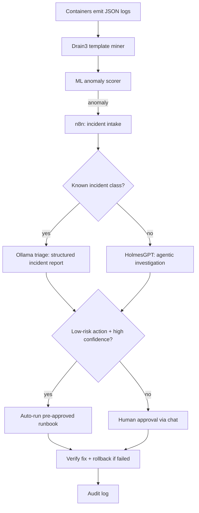
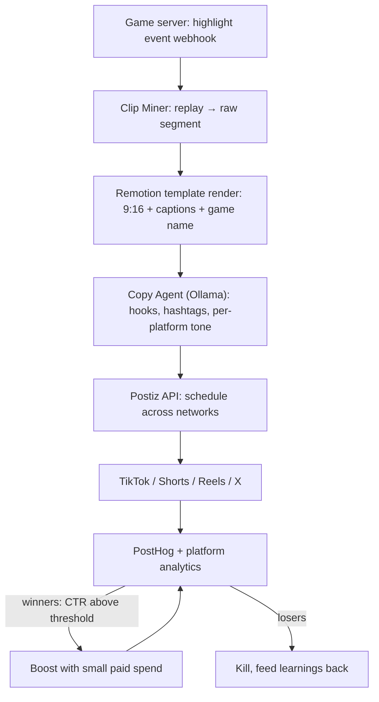

# 🏗️ Dual Architecture Blueprint
## Open-Source Log-Reading Loop + Automated Promotion Agents

*Implementation and setup protocol for the two AI-agent systems that run a solo game studio: the AI IT team (infrastructure) and the promotion engine (marketing).*

---

# Executive Summary

This blueprint specifies two agent architectures, both fully self-hostable, both built on the **same three foundations**: Docker, **n8n** as the orchestration backbone, and **Ollama** as the local model runtime.

| | Architecture I — AI Ops Loop | Architecture II — Promotion Engine |
|---|---|---|
| **Purpose** | Keep servers alive without a human on-call | Manufacture, edit, and distribute game clips daily |
| **Core insight** | Cheap ML detects anomalies; the LLM diagnoses them — never the reverse | The engine is the platform; games are variables passing through it |
| **License cost** | $0 | $0 (solo dev) |
| **Replaces** | ~A junior sysadmin's toil | ~20 hrs/week of marketing labor |
| **Risk profile** | Approval-gated; autonomous only for low-risk actions | Human stays creative director; agents run the factory |

**Why these two together:** the promotion engine only works if the game servers are alive, and the ops loop only matters if the game is worth keeping alive. They share one n8n instance, one Ollama service, one audit discipline, and one box. A single 16 GB VPS (~€25–40/month, estimate) can run both stacks at studio scale, with the option to split into two boxes later.

**The golden rule for both systems:** agents draft and execute the routine; humans own the irreversible decisions — bans, launches, money, and anything touching production infrastructure without a pre-approved runbook.

---

# Shared Foundation (build once, used by both)

## Components

| Component | Role | License |
|---|---|---|
| Docker Compose | Everything runs as containers on one or two Linux VMs | Free |
| **n8n** | Orchestration backbone: webhooks, agent nodes, human-approval gates, schedules | Fair-code; free self-hosted for internal use |
| **Ollama** | Local model runtime (triage brain, copy drafting) | MIT-core |
| Postgres + Redis | Shared databases | Free |

## Setup Protocol — Foundation (Day 1–2)

1. **Provision** one Linux VM, Ubuntu 24.04, 16 GB RAM / 4 vCPU / 100 GB disk (estimated floor for both stacks; Ollama with a 7B model alone wants ~6–8 GB).
2. **Install Docker + Compose plugin**; enable unattended security upgrades.
3. **Deploy n8n self-hosted** (Docker): set `N8N_ENCRYPTION_KEY`, persist `~/.n8n` volume, put behind a reverse proxy with HTTPS.
4. **Deploy Ollama** (`ollama serve` as a container or systemd); pull one small model for ops triage (e.g. a 3–8B instruct model with tool-calling support) and note that n8n connects to it via its LangChain/native model connectors, which also support LM Studio and vLLM.
5. **Deploy shared Postgres + Redis** instances for all services.
6. **Backups from day one:** nightly `pg_dump` of every database + volumes to offsite storage; test one restore before going further.
7. **Wire n8n ↔ Ollama** with a trivial test workflow (prompt in, structured JSON out) to validate the loop before building anything on it.

---

# Architecture I — The Open-Source Log-Reading Loop (AI IT Team)

## Design principles

1. **ML detects, the LLM diagnoses.** This is the most important verified finding: classical ML over engineered log features reached F1 = 0.9998 on anomaly detection while zero-shot LLM detection scored 0.79. The LLM is the wrong detector and the right investigator.
2. **Structured logs in, structured incidents out.** Every container emits single-line JSON logs; the loop's output is a structured incident report, not prose.
3. **Phased autonomy.** Advisory (weeks 1–4) → supervised, human-approves (weeks 5–8) → autonomous for pre-approved low-risk actions only (week 9+). This mirrors the industry-standard maturity ladder.
4. **Guardrails are the product.** Blast-radius limits, global kill switch, dry-run mode, approval workflow, audit log for every action.

## Component matrix

| Layer | Tool | License | Job |
|---|---|---|---|
| Log templating | **Drain3** (logpai/IBM) | MIT | Streams raw logs into stable templates in real time; masking of IPs/numbers; state persistence to Redis/Kafka/file |
| Detection library | **LogAI** (logpai) | Open source | One-stop: parsing, clustering, time-series/ML/deep-learning anomaly detection, OpenTelemetry-compatible |
| Detection alternatives | **Loglizer**, **LogDeep** | Open source | Anomaly-detection toolkits if LogAI's approach doesn't fit |
| Agentic investigator | **HolmesGPT** | Apache 2.0 (CNCF Sandbox) | Multi-step read-only investigation over logs, metrics, APIs; any stack, no Kubernetes required |
| Triage brain | Ollama (small local model) | Free | Classifies known incident classes, drafts structured incident reports |
| Orchestration & gates | n8n | Fair-code | Webhook intake, routing, approvals, runbook execution, audit |

## Architecture

## Setup Protocol — Log Loop

### Phase 1: Log pipeline (Week 1)
1. **Standardize logging:** all services (FastAPI, game server, workers) emit single-line JSON logs to stdout with fields: `ts, level, service, event, trace_id`. This is the loop's fuel — no pipeline survives unstructured logs.
2. **Deploy Drain3** (`pip install drain3`, or as a small Python sidecar service consuming a log stream). Configure masking (IPs, numbers, emails) via its `.ini` masking rules so templates stabilize.
3. **Persist Drain3 state** to Redis so learned templates survive restarts; enable snapshotting.
4. Route logs to the pipeline: simplest viable option is a log shipper feeding a Redis/Kafka topic that the Drain3 service consumes; keep one raw-log archive volume for forensics.

### Phase 2: Detection (Week 2)
1. **Start embarrassingly simple:** per-template frequency counters over sliding windows (template X appears 20× more than baseline) catch most operational incidents. Ship this first.
2. **Add ML scoring when baseline data exists:** LogAI (or a small Isolation Forest / Random Forest over Drain3 features) trained on normal-operation logs only. Expect classical ML to beat fancy deep learning — that is the verified result.
3. **Emit anomalies as events** to an n8n webhook: `{service, template_id, anomaly_score, samples, ts}`.

### Phase 3: Triage brain (Week 3)
1. **Create the incident runbook library first** — a git repo of runbooks: one markdown file per known failure class (container OOM, crash loop, DB connection exhaustion, disk full, cert expiry, failed deploy). The agent is only as good as this library.
2. **n8n workflow:** anomaly webhook → fetch recent log context + service metadata → Ollama with a strict output schema: `{incident_class, severity 1-5, root_cause_hypothesis, suggested_fix, confidence 0-1, runbook_ref}`.
3. **Route:** confidence ≥ threshold AND `incident_class` in the known list → remediation lane. Anything else → investigation lane. Everything lands in your chat with the structured report attached.
4. **Run in advisory mode** (alert only, no actions) for the whole first month. Tune false-positive rate until you trust it.

### Phase 4: Agentic investigation (Week 4–5)
1. **Install HolmesGPT** via `pipx install holmesgpt` (or Homebrew/Docker; a prebuilt container exists). Verify with `holmes ask --help`.
2. **Start with a hosted model** (Claude/OpenAI API key), not Ollama — HolmesGPT's own docs flag its Ollama support as experimental with limited tool-calling. Validate the whole loop first; move to Ollama later only if privacy demands it.
3. **Add data sources:** REST API toolsets for anything you want investigated (databases, cloud providers, your own FastAPI admin endpoints). No Kubernetes required — it works with VMs, Docker, any stack.
4. **Wire into n8n:** unknown-incident lane → `holmes ask` (CLI call or HTTP) with the incident context → investigation report back into the same approval flow.
5. Optional later: **Operator mode** for 24/7 background scanning (runs in Kubernetes), or keep cron-triggered sweeps via n8n.

### Phase 5: Remediation gates (Week 6–7)
1. **Action registry** in n8n: the only executable actions are pre-approved, low-risk, reversible: restart crashed container, clear cache, scale up worker, rollback last deploy. Everything with a blast radius beyond one container requires human approval, always.
2. **Dry-run mode first:** every action logs what it *would* do for a week before doing it.
3. **Kill switch:** a global n8n toggle that freezes all automated actions; also freeze automatically if anomaly rate exceeds a threshold (avoid remediation storms).
4. **Verify + rollback:** after any action, re-check the anomaly that triggered it; if still firing, roll back and page the human.
5. **Audit log:** every decision records trigger, diagnosis, policy decision, action, verification, outcome — replayable. Note: with the EU AI Act in full force since August 2026, systems autonomously modifying production infrastructure are treated as high-risk; audit trails and human oversight are the compliant shape anyway.

### Phase 6: Validation (Week 8+)
1. **Chaos drills monthly:** deliberately break things (kill a container, fill a disk in staging) and grade the loop: detected? correct class? correct fix? time to resolution?
2. **Promote actions** from "requires approval" to "autonomous" one at a time, only after 5 consecutive correct handling in drills.
3. **Track:** false-positive rate, MTTD, MTTR, percentage of incidents resolved without human touch, on-call hours saved.

---

# Architecture II — The Automated Promotion Engine

## Design principles

1. **The engine is the platform.** Games are variables; the clip factory is the constant. Every portfolio game runs through the identical machine.
2. **The funnel is clip → link → playing in 5 seconds.** Every clip carries the game name on screen and a direct link; conversion collapses if viewers must search.
3. **Volume with a feedback loop.** 3–5 clips/week/platform during campaigns; paid organic: boost only clips showing natural traction ($50–150), kill losers daily.
4. **Human stays creative director.** Agents draft, edit, schedule, and report; you approve winners and decide what the game *is*.

## Component matrix

| Agent role | Tool | License | Job |
|---|---|---|---|
| Clip renderer | **Remotion** | Free for individuals/teams ≤3 people | Programmatic 9:16 clips from templates: captions, hook text, game-name end card |
| Orchestration | **n8n** | Fair-code | Every agent below is an n8n workflow calling Ollama |
| Scheduler + publisher | **Postiz** | AGPL-3.0; free self-hosted | Publishes to 30+ networks from one calendar; API + native n8n node; AI-agent-native (MCP server, CLI) |
| Triage/copy brain | Ollama | Free | Hooks, captions, hashtags per platform tone |
| Analytics | PostHog | Open source | Event data → weekly digest → boost/kill decisions |

## Architecture

## Setup Protocol — Promotion Engine

### Phase 1: Accounts & platform apps (Week 1)
1. **Register developer apps** on every target platform (TikTok, YouTube, Instagram/Meta, X). This is the slowest external dependency — OAuth reviews take days to weeks. Budget an evening per platform.
2. **Create the game's social accounts** and a press kit page (single page: name, hook sentence, 3 GIFs, press contact).
3. **Decide the posting identity:** one brand account per game, one studio account that cross-promotes all portfolio games.

### Phase 2: Postiz self-host (Week 1–2)
1. **Clone the official compose repo** (`gitroomhq/postiz-docker-compose`) — it ships Postiz pre-wired with Postgres, Redis and Temporal (required since v2.12). Tested floor: 2 GB RAM / 2 vCPU; plan 4 GB+ realistically (the stack runs ~3 GB).
2. **Configure** via environment variables: `DATABASE_URL`, `REDIS_URL`, `TEMPORAL_ADDRESS`, storage (local filesystem works; Cloudflare R2 optional). Set `DISABLE_REGISTRATION=true` immediately after creating your owner account — self-hosted instances are open by default.
3. **HTTPS mandatory:** Postiz sets secure cookies, so put a reverse proxy with TLS in front before first login.
4. **Connect channels** one by one with your developer-app credentials (30+ networks supported).
5. **Backups:** `pg_dump` of the Postiz database + the uploads volume + the `.env` (contains `JWT_SECRET`). Losing these means re-authing every channel.
6. Note the escape hatch: Postiz Cloud exists from ~$29/month if self-hosting ever becomes a chore; your data and connected channels would migrate with you.

### Phase 3: n8n agent workflows (Week 2–3)
Build these five workflows, each calling Ollama for the language parts:
1. **Clip intake:** webhook receives `{game_id, event_type, replay_ref, ts}` from the game server's highlight detector.
2. **Copy agent:** for each target platform, generate hook text (≤1.5-second hook rule), caption, hashtags, in *that platform's* tone; always include the game name + link. Human reviews a sample; auto-approve the rest once tone is dialed in.
3. **Publishing:** push clip + per-platform copy to Postiz via its API/native n8n node, scheduled at each platform's peak times.
4. **Performance digest:** daily/weekly pull of clip metrics → Ollama ranks by CTR/retention → digest in your chat: top 3, bottom 3, hypothesis.
5. **Paid-organic gate:** clips above a CTR threshold get flagged for boosting (Meta/TikTok ads APIs); you set the weekly budget ceiling in n8n; the agent never exceeds it.

### Phase 4: Remotion clip template (Week 3–4)
1. **Scaffold** with `npm create video@latest`; build ONE 10-second vertical template: background gameplay segment, bold hook text in the first frames, TikTok-style captions (Remotion ships a captions helper module for exactly this), game-name end card + link.
2. **Parameterize:** `{video_url, hook_text, caption_text, game_name, link}` as props → one template renders unlimited variants.
3. **Batch render on your own infrastructure** (CPU-heavy: Chromium per frame). Solo dev/≤3 people: free; a 4+ person company needs a Remotion license; heavy automation tiers run ~$0.01/render.
4. **Wire into n8n:** clip intake → fetch replay segment (ffmpeg cut) → `npx remotion render` per platform → output to Postiz upload folder.

### Phase 5: In-game clip miner (Week 4–6, the one custom build)
1. **Deterministic replays:** log input events per match so any moment can be re-rendered server-side — this is the compounding asset, worth engineering properly.
2. **Highlight detector:** your FastAPI game server flags spike events (shrunken-cube near-miss, kill streaks, >5-player pileups) and fires the webhook from the flow above.
3. **Auto-clip on death in spectacular conditions** — the drama moments are the marketing.

### Phase 6: Analytics feedback loop (ongoing)
1. PostHog captures join→play conversion, session length, D1/D7 — the *product* side; platform APIs give the *clip* side.
2. Weekly, the digest agent joins both: which clip hooks produced players who *stayed*? That correlation — not raw views — drives template evolution.
3. Rule: never spend on ads before D1 retention ≥ 25%; the engine enforces this by only boosting once the gate passes.

---

# What Stays Human (both systems)

| Never automate | Why |
|---|---|
| Ban/PR/public statements | Agents draft; you send. One bad automated message outlives a thousand good ones |
| Kill/scale game decisions | Agents surface data; portfolio judgment is taste |
| Influencer relationships | Creators smell mass DMs; agents prepare lists and drafts, you talk |
| Production changes outside the runbook registry | The 5% of incidents the agent gets wrong are the critical ones |
| Ad budget changes | Agents enforce ceilings; you set them |

---

# Deployment & Cost Summary (estimates)

| Item | Spec | Cost |
|---|---|---|
| VPS (both stacks, solo scale) | 16 GB RAM / 4 vCPU / 100 GB | ~€25–40/month |
| Ollama model (ops triage) | 3–8B instruct, tool-calling capable | ~6–8 GB RAM, no GPU needed |
| HolmsGPT hosted-model calls | deep investigations only | LLM API pennies per incident |
| Postiz stack | ~3 GB RAM | $0 self-hosted |
| Remotion renders | CPU spikes, batch | $0 (solo) |
| License total | MIT/Apache/fair-code/AGPL as above | $0 |
| Optional escape hatches | Postiz Cloud ~$29/mo; Remotion license at 4+ people; frontier LLM API | only when earned |

---

# Sources

**Ops loop:** [Drain3 (MIT)](https://github.com/logpai/Drain3) · [LogAI](https://github.com/Asierzubia/logai) · [Drain3 vs Loglizer vs LogDeep — Pi Stack](https://www.pistack.xyz/posts/2026-06-15-self-hosted-log-anomaly-detection-drain3-loglizer-logdeep/) · [RF beats LLM on log anomaly detection](https://github.com/Iditc/log-anomaly-detection) · [LLM log anomaly benchmark — arXiv](https://arxiv.org/html/2604.12218) · [Self-hosted closed-loop AIOps reference](https://github.com/yuvrajpawar09/AI-Ops) · [HolmesGPT (CNCF)](https://github.com/HolmesGPT/holmesgpt/blob/master/README.md) · [HolmesGPT CLI install](https://github.com/HolmesGPT/holmesgpt/blob/master/docs/installation/cli-installation.md) · [HolmesGPT Ollama docs](https://github.com/HolmesGPT/holmesgpt/blob/master/docs/ai-providers/ollama.md) · [HolmesGPT fault benchmark — Aurora SRE](https://www.aurorasre.ai/blog/holmesgpt-vs-k8sgpt) · [Guardrails & phased autonomy — mylinux.work](https://mylinux.work/guides/agentic-ai-infrastructure-ops/) · [EU AI Act & self-healing systems](https://devops.gheware.com/blog/posts/self-healing-devops-ai-agents-2026.html)

**Promotion engine:** [Postiz](https://postiz.com/) · [Postiz system requirements](https://docs.postiz.com/self-host/installation/system-requirements) · [Postiz Docker Compose](https://docs.postiz.com/self-host/installation/docker-compose) · [Postiz self-host ops guide — Lineserve](https://www.lineserve.net/blog/install-and-configure-postiz) · [n8n](https://n8n.io/) · [n8n self-hosted AI guide — phluit](https://phluit.com/blog/self-hosted-n8n-ai-automation-guide) · [Remotion](https://www.remotion.dev/) · [Remotion GitHub](https://github.com/remotion-dev/remotion) · [Remotion captions API](https://www.remotion.dev/docs/api) · [Remotion automation pricing](https://www.remotion.dev/automate)